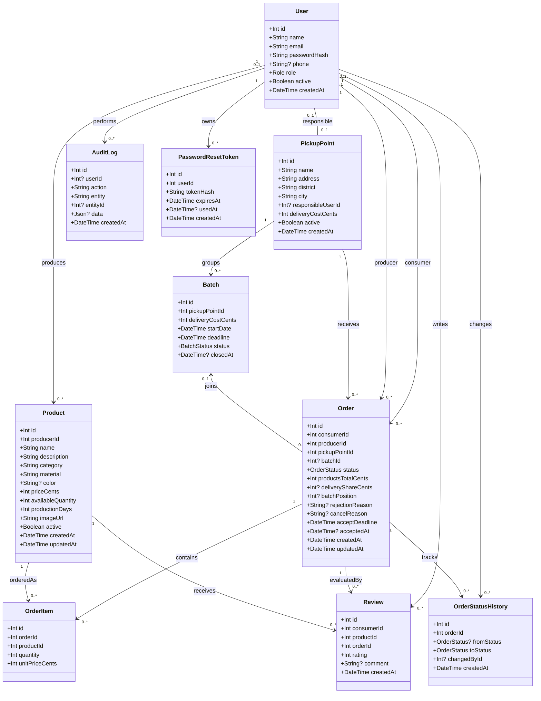

# Diagrama de classes — PrintHub Regional

Diagrama derivado do arquivo `backend/prisma/schema.prisma`. Os atributos opcionais são indicados com `?`. As cardinalidades representam as relações no esquema; validações adicionais podem ser aplicadas pelos serviços.

## Observações sobre o modelo

- `PickupPoint.responsibleUserId` é opcional e possui `@unique`: um usuário pode ser responsável por no máximo um ponto de retirada.
- `Order.batchId` é opcional: um pedido pode estar sem lote ou associado a um único lote; um lote pode reunir vários pedidos.
- `OrderStatusHistory.changedById` e `AuditLog.userId` são opcionais, permitindo registrar eventos automáticos ou sem usuário associado.
- `OrderItem` tem restrição `@@unique([orderId, productId])`; `Review` tem `@@unique([orderId, productId])`.
- `OrderItem` e `OrderStatusHistory` usam `onDelete: Cascade` em suas relações com `Order`; isso descreve a regra do banco, não a existência de uma operação comum de exclusão de pedidos na interface.
- O esquema não impõe por cardinalidade um mínimo de um item por pedido; esse requisito deve ser garantido pela lógica de negócio.
